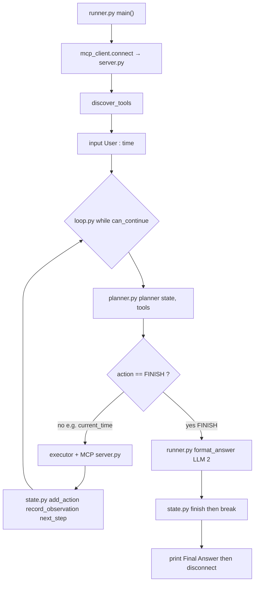
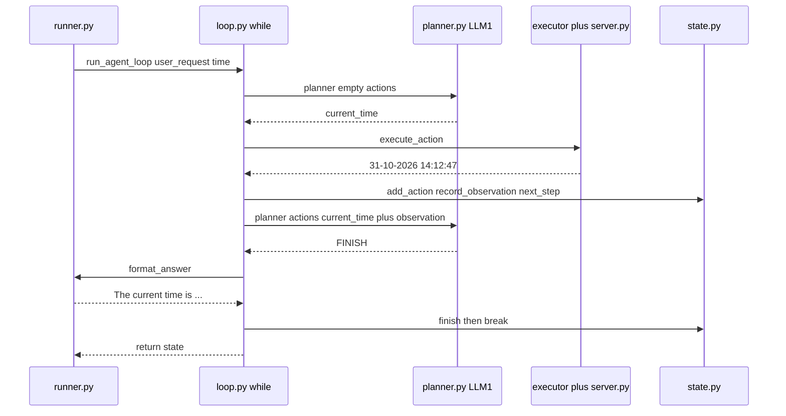

# MCP agent loop — `runner.py` and friends

Hands-on **looping MCP agent**: tools still live on an MCP **server** (same three tools as PROJECT_3), but the planner no longer fires **once**. A **state** dict remembers what already happened. A **while loop** asks the planner for the **next** action until it returns `FINISH` (or `max_steps` is hit). Then a second LLM call turns the collected observations into a natural answer.

**PROJECT_3** ([`9_mcp_agent_lab.md`](../../19_MCP_MODEL_CONTEXT_PROTOCOL/PROJECT_3/9_mcp_agent_lab.md)) = plan **once** → run **one** tool → answer.  
**Topic 18** ([`2_assistant_planner_tools.md`](../../18_AI_AGENTS_INTRO/2_assistant_planner_tools.md)) = same one-tool-per-turn idea, tools in **`tools.py`**.  
**This folder** (`20_MCP_AGENT_LOOP/PROJECT_1/`) = PROJECT_3 tools + MCP, plus **observe → plan → act → remember** repeated.

Read first: PROJECT_3 lab · Topic 18 planner idea · chapter [`README.md`](../README.md).

| File | Role |
|------|------|
| [`server.py`](./server.py) | MCP **server** — `current_time`, `roll_dice`, `generate_password` |
| [`mcp_client.py`](./mcp_client.py) | MCP **client** helpers — connect, list, call, disconnect |
| [`state.py`](./state.py) | **Memory** — dict helpers (`create_state`, `add_action`, …) |
| [`loop.py`](./loop.py) | Heart of the agent — `run_agent_loop` |
| [`planner.py`](./planner.py) | **LLM #1** — next tool name **or** `FINISH` |
| [`executor.py`](./executor.py) | Name → MCP `call_tool` → plain text |
| [`runner.py`](./runner.py) | **Entry point** — MCP + loop + **LLM #2** |
| [`test_state.py`](./test_state.py) | State only — no LLM, no MCP |

MCP-only smoke test (no LLM): **[`PROJECT_2/test_client.py`](../../19_MCP_MODEL_CONTEXT_PROTOCOL/PROJECT_2/test_client.py)**.  
State-only smoke test (no MCP): **`python test_state.py`**.

**Read this first for the call chain:** [Who calls whom — files and functions](#who-calls-whom--files-and-functions).  
**Why `time` prints the planner twice then `FINISH`:** [Real run — `User : time`](#real-run--user--time).

---

## Requirements

```bash
pip install fastmcp openai python-dotenv
```

| Package | Used for |
|---------|----------|
| `fastmcp` | `FastMCP` on the server, `Client` on the client |
| `openai` | Planner (`planner.py`) + answer (`format_answer` in `runner.py`) |
| `python-dotenv` | Load `.env` |

`.env` example (folder you run from, or a parent folder `load_dotenv()` can find):

```env
OPENAI_API_KEY=your_key_here
MODEL_NAME=gpt-4o-mini
```

| Variable | Used for |
|----------|----------|
| `OPENAI_API_KEY` | `OpenAI(api_key=...)` in [`planner.py`](./planner.py) and [`runner.py`](./runner.py) |
| `MODEL_NAME` | `model=` on both **planner** and **answer** Chat Completions calls |

Use a **current** model id. Retired ids return **404 `model_not_found`**.

---

## How to run

From **`PROJECT_1`** (this folder):

**1. State only (no keys, no MCP):**

```bash
python test_state.py
```

**2. Full agent (starts `server.py` as a subprocess):**

```bash
python runner.py
```

You do **not** start `server.py` in a second terminal.

1. FastMCP may print a stdio banner. Then **Connected to MCP Server.**  
2. **Available Tools** lists `current_time`, `roll_dice`, `generate_password`.  
3. Type a request after `User : ` (one request, then the loop runs).  
4. Each planner choice prints `Planner Selected: ...`.  
5. **Final Answer:** is the LLM #2 sentence.

Try a **two-tool** request so the loop actually loops:

```text
User : Generate a password and tell me the current time.
```

One-tool request (the run explained below):

```text
User : time
```

---

## Real run — `User : time`

**What you run:** [`runner.py`](./runner.py) (`python runner.py`).  
That file calls [`loop.py`](./loop.py) `run_agent_loop`. The loop calls [`planner.py`](./planner.py) `planner` **once per `while` pass**. Debug prints (`Tool Descriptions` / `Prompt`) live in **`planner.py`**, so they appear **once per planner call**, not once per user line.

This is a **real** run of that command with `User : time`. Times in observations will differ on your machine.

### Files in this run (who does what)

```text
python runner.py                          ← you start here (runner.py)
        │
        ├─ mcp_client.py  connect()       ← starts server.py (MCP subprocess)
        ├─ mcp_client.py  discover_tools()
        ├─ input("User : ")               ← you type: time
        │
        └─ loop.py  run_agent_loop(...)   ← the while loop
                │
                ├─ planner.py  planner()  ← LLM #1  (pass 1 and pass 2)
                ├─ executor.py + mcp_client.py + server.py   ← only if action is a tool
                ├─ state.py    add_action / record_observation / next_step / finish
                └─ runner.py   format_answer()   ← LLM #2, only when action is FINISH
```



### Why you see the planner block **twice**

[`loop.py`](./loop.py) is a **`while`**, not a single call:

```6:21:loop.py
    while can_continue(state):
        action = planner(state, tools)
        print("Planner Selected:", action)
        if action == "FINISH":
            answer = format_answer(state)
            finish(state, answer)
            break
        observation = await execute_action(action, client)
        add_action(state, action)
        record_observation(state, action, observation)
        next_step(state)
```

| After this line | If `action` is `current_time` | If `action` is `FINISH` |
|-----------------|-------------------------------|-------------------------|
| Line 8 `planner(...)` | LLM returns a **tool name** | LLM returns the **word** `FINISH` |
| Line 10 `if action == "FINISH"` | False → skip 11–13 | True → `format_answer`, `finish`, **`break`** (leave the `while`) |
| Lines 15–21 | Run MCP, write state, **`while` starts over at line 6** | Not reached |

Python does not “call planner twice” as a special feature. After lines 15–21 the `while` **body ends**, so execution goes **back to line 6**. `can_continue` is still true, so **line 8 runs again**. That second line 8 is the second `Tool Descriptions` / `Prompt` dump.

`FINISH` is **not** a function in `state.py` and **not** an MCP tool. It is a **string** the model is told to return (planner prompt rules 4–5). `state.py` `finish(state, answer)` only **stores** the final sentence after that string is seen.

### Pass 1 — “what tool do I need?”

**Code:** [`loop.py`](./loop.py) line 8 → [`planner.py`](./planner.py) `planner(state, tools)` → `build_tool_descriptions` prints tools → prompt printed → OpenAI Chat Completions → `return ...strip()`.

**State the model sees (justification):**

| Prompt field | Value this pass | Why |
|--------------|-----------------|-----|
| User Request | `time` | Exact string from `input()` in [`runner.py`](./runner.py) |
| Completed Actions | `[]` | No tool has run yet |
| Previous Observations | `[]` | Nothing from MCP yet |
| Available Tools | `current_time`, `roll_dice`, `generate_password` | From MCP `list_tools()` in [`mcp_client.py`](./mcp_client.py) |

**What the model should do:** pick **one** tool name. `time` matches `current_time` (“Return the current date and time”). It must **not** return `FINISH` yet — observations are empty, the clock has not been read.

**What you see:**

```text
Planner Selected: current_time
```

**What happens next (not FINISH):** [`loop.py`](./loop.py) lines 15–21.

| Step | File | Justification |
|------|------|----------------|
| `execute_action(action, client)` | [`executor.py`](./executor.py) → [`mcp_client.py`](./mcp_client.py) `call_tool` | Run the **server** function, not a Python `import` of [`server.py`](./server.py) |
| `current_time()` | [`server.py`](./server.py) | Returns e.g. `31-10-2026 14:12:47` |
| `add_action(state, "current_time")` | [`state.py`](./state.py) | Memory: we already used this tool |
| `record_observation(...)` | [`state.py`](./state.py) | Memory: the actual clock string |
| `next_step(state)` | [`state.py`](./state.py) | `current_step` 0 → 1 |
| **no `break`** | [`loop.py`](./loop.py) | Back to `while` line 6 |

### Pass 2 — “is the request already done?”

**Same code path again:** [`loop.py`](./loop.py) line 8 → [`planner.py`](./planner.py). That is why this block prints **again**. Compare the prompt to pass 1; only **state** changed:

| Prompt field | Pass 1 | Pass 2 (your run) |
|--------------|--------|-------------------|
| User Request | `time` | `time` (unchanged) |
| Completed Actions | `[]` | `['current_time']` |
| Previous Observations | `[]` | `[{'step': 0, 'action': 'current_time', 'observation': '31-10-2026 14:12:47'}]` |

**Why the model returns `FINISH` (not another tool):**

The prompt in [`planner.py`](./planner.py) says:

1. One next action only.  
2. **Never repeat** a completed action → cannot pick `current_time` again.  
3. Use observations for what is **still** required → you already have the time string.  
4. If the request is **completely satisfied**, return `FINISH`.  
5. Return **only** the tool name or `FINISH`.

User asked only `time`. Observation already has the datetime. Dice and password are unused on purpose. So the model’s next action is the stop word:

```text
Planner Selected: FINISH
```

That string is **created by the LLM** (`planner.py` `return response.choices[0].message.content.strip()`). [`loop.py`](./loop.py) only **checks** it:

```10:13:loop.py
        if action == "FINISH":
            answer = format_answer(state)
            finish(state, answer)
            break
```

| Call | File | Justification |
|------|------|----------------|
| `format_answer(state)` | [`runner.py`](./runner.py) | **LLM #2** — turn observations into a sentence; does not mention tools/state |
| `finish(state, answer)` | [`state.py`](./state.py) | Sets `final_answer` and `finished = True` |
| `break` | [`loop.py`](./loop.py) | Leave the `while` — **this** is why the process does not plan a third time |

Then [`runner.py`](./runner.py) prints `state["final_answer"]` and `disconnect`s. There is **no** chat `while True` in `main()`, so the Python process exits. That is not `max_steps` (that would be five **tool** calls without `FINISH`).

Example final line from that run:

```text
Final Answer:
The current time is 31st October 2026, 14:12:47.
```

### One picture of both passes

```text
while can_continue:                         # loop.py line 6
    action = planner(state, tools)          # loop.py line 8  → planner.py

    # PASS 1  action == "current_time"
    #   if FINISH?  no
    #   MCP current_time  →  "31-10-2026 14:12:47"
    #   state.actions = ['current_time']
    #   next_step  →  back to while

    # PASS 2  action == "FINISH"            # model read rule 4
    #   if FINISH?  yes
    #   format_answer (runner.py) + finish (state.py) + break
```



If the user had typed **password and time**, pass 2 would likely be the **other tool**, not `FINISH`, and pass 3 would be `FINISH`. Same `while` / same line 8.

---

## What this chapter teaches

An **agent loop** is not a chatbot transcript. It is a **control loop** in **your** Python:

1. Look at **state** (user goal + what already ran + what came back).  
2. **Plan** the next single action (LLM).  
3. **Act** (MCP tool) **or** stop (`FINISH`).  
4. **Record** the observation.  
5. Repeat until done or a **step budget** (`max_steps`, default **5**).

The LLM is **stateless**. The dict in `state.py` is the memory. Every planner call gets the **full** `actions` and `observations` lists pasted into the prompt.

```text
Topic 18 / PROJECT_3 (one shot)          This folder (loop)
────────────────────────────────         ──────────────────────────────
choose_tool(request) → one name          while can_continue(state):
execute once                               action = planner(state, tools)
answer from that one result                  if FINISH → format_answer → break
                                           else execute → remember → next_step
```

Why PROJECT_3 is not enough: “Generate a password **and** tell me the time” needs **two** tools. A one-shot planner can pick only one name. The loop lets it pick `generate_password`, see the password, then pick `current_time`, then `FINISH`.

---

## Who calls whom — files and functions

### Entry point (what you run)

| You run | Starts in | Never imports |
|---------|-----------|----------------|
| `python runner.py` | [`runner.py`](./runner.py) → `asyncio.run(main())` | **`server.py` is not imported** as a Python module |
| `python test_state.py` | [`test_state.py`](./test_state.py) | No MCP, no OpenAI |

The server is started by **`mcp_client.connect()`** → `Client("server.py")` → FastMCP spawns **`server.py`**.

### Import map (Python `import` only)

```text
runner.py
    │
    ├── from mcp_client import connect, disconnect, discover_tools
    │         └── from fastmcp import Client
    │
    ├── from planner import planner          (LLM #1)
    ├── from executor import execute_action
    │         └── from mcp_client import execute_tool
    ├── from loop import run_agent_loop
    │         └── from state import create_state, add_action, ...
    └── from openai import OpenAI            (LLM #2 in format_answer)

planner.py
    └── OpenAI (LLM #1)

server.py
    └── from fastmcp import FastMCP
    └── @mcp.tool() → current_time, roll_dice, generate_password
```

**Important:** `runner.py` never does `from server import roll_dice`. The planner may return the string `roll_dice`, but **`execute_tool`** sends MCP **`tools/call`** to the **server process**.

### Master table — who calls what

Think in **phases**. The new part vs PROJECT_3 is **phase E looping**.

| Phase | You run / call | What happens (plain English) |
|-------|----------------|------------------------------|
| **A — Start** | `runner.py` → `asyncio.run(main())` | `load_dotenv()`, OpenAI client for LLM #2 |
| **B — Connect** | `await connect()` | Spawn **`server.py`**; MCP session open |
| **C — Discover** | `await discover_tools(client)` | `list_tools()` → names + descriptions |
| **D — Ask user** | `input("User : ")` | One request for the whole loop |
| **E — Loop** | `await run_agent_loop(...)` | Repeat plan → act → remember |
| **E1 — Plan** | `planner(state, tools)` | LLM #1 → tool name **or** `FINISH` |
| **E2a — Stop** | `format_answer(state)` then `finish` | LLM #2 uses **all** observations |
| **E2b — Act** | `await execute_action(action, client)` | MCP `call_tool` on **`server.py`** |
| **E3 — Remember** | `add_action` / `record_observation` / `next_step` | Mutate the state dict |
| **F — Print** | `print(state["final_answer"])` | User-facing reply |
| **G — Stop MCP** | `await disconnect(client)` | Close session; server subprocess exits |

#### Four layers

| Layer | Files | Job |
|--------|--------|-----|
| **1 — Runner** | `runner.py` | User I/O, MCP connect, **LLM #2**, print answer |
| **1b — Loop + state** | `loop.py`, `state.py` | Control flow + memory |
| **1c — Planner** | `planner.py` | **LLM #1** — next action only |
| **1d — Executor** | `executor.py` | Unwrap MCP result text |
| **2 — Client API** | `mcp_client.py` | `connect`, `discover_tools`, `execute_tool`, `disconnect` |
| **3 — Library + server** | `fastmcp` + `server.py` | Wire protocol + tool implementations |
| **4 — OpenAI-compatible API** | `planner.py` + `runner.py` | **Not** part of MCP |

```text
runner.main()
    │
    ├─► mcp_client.py ──► fastmcp.Client ──stdio──► server.py
    │
    └─► run_agent_loop()
            ├─► planner()          LLM #1  (many times)
            ├─► execute_action()   MCP
            └─► format_answer()    LLM #2  (once, on FINISH)
```

#### Detail table (file + function names)

| Step | From | Function | To | Effect |
|------|------|----------|-----|--------|
| 1 | `runner.py` | `main()` | `mcp_client.py` | `connect()` |
| 2 | `mcp_client.py` | `connect()` | fastmcp | spawn **`server.py`**, `__aenter__()` |
| 3 | `runner.py` | `main()` | `mcp_client.py` | `discover_tools()` → `list_tools()` |
| 4 | `runner.py` | `main()` | stdin | `input()` → `user_request` |
| 5 | `loop.py` | `run_agent_loop()` | `state.py` | `create_state(user_request)` |
| 6 | `loop.py` | (while) | `planner.py` | `planner(state, tools)` |
| 7a | `loop.py` | if `FINISH` | `runner.py` | `format_answer(state)` → `finish` → `break` |
| 7b | `loop.py` | else | `executor.py` | `execute_action` → `execute_tool` → `call_tool` |
| 8 | `server.py` | `@mcp.tool` | — | e.g. `current_time()` |
| 9 | `loop.py` | | `state.py` | `add_action`, `record_observation`, `next_step` |
| 10 | `runner.py` | `main()` | stdout | print `final_answer` |
| 11 | `runner.py` | `main()` | `mcp_client.py` | `disconnect()` |

### LLM #1 vs LLM #2

| Label | Function | File | Input | Output |
|-------|----------|------|-------|--------|
| **LLM #1** | `planner(state, tools)` | `planner.py` | **Whole state** + MCP tool list | One tool name **or** `FINISH` |
| **LLM #2** | `format_answer(state)` | `runner.py` | User request + **all** actions + observations | Natural sentence |

PROJECT_3 `choose_tool(user_request, tools)` saw **only** the user line.  
Here `planner(state, tools)` also sees **`state["actions"]`** and **`state["observations"]`**, so it can avoid repeating a completed tool.

PROJECT_3 `answer_user(user_request, tool_output)` saw **one** tool result.  
Here `format_answer(state)` sees the **list** of observations from the whole loop.

### One-line summary

**`runner.py`** → **`loop.py` + `state.py`** + **OpenAI (planner × N, answer × 1)** → **`mcp_client.py`** → **`fastmcp.Client`** → (stdio) → **`server.py`**.

---

## Why “state” exists

LLMs do not remember previous calls. If you only send “user asked for password and time” every time, the planner might call `generate_password` twice.

State is a **plain Python dict** (not a class). Helpers in `state.py` mutate it in place.

| Key | Meaning |
|-----|---------|
| `user_request` | Original string from `input()` — never changes |
| `current_step` | How many **executed** actions so far (starts at `0`) |
| `max_steps` | Safety cap (default **5**) so a confused planner cannot loop forever |
| `actions` | List of tool **names** already run |
| `observations` | List of `{step, action, observation}` dicts |
| `finished` | `True` after `FINISH` + `format_answer` |
| `final_answer` | LLM #2 text (empty until finish) |

`can_continue` is true only when **not** finished **and** `current_step < max_steps`.

**Note:** `FINISH` does **not** go through `add_action` / `next_step`. The loop `break`s. If the planner never says `FINISH`, the loop stops after 5 tool calls and `final_answer` may stay empty (see [Limitations](#limitations-this-lab-is-honest-about)).

---

## Walkthrough — `state.py`

### Full source (reference)

```python
def create_state(user_request, max_steps=5):
    return {
        "user_request": user_request,
        "current_step": 0,
        "max_steps": max_steps,
        "actions": [],
        "observations": [],
        "finished": False,
        "final_answer": ""
    }

def add_action(state, action):
    state["actions"].append(action)

def record_observation(state, action, observation):
    state["observations"].append({"step": state["current_step"], "action": action, "observation": observation})

def next_step(state):
    state["current_step"] += 1

def can_continue(state):
    return not state["finished"] and state["current_step"] < state["max_steps"]

def finish(state, answer):
    state["final_answer"] = answer
    state["finished"] = True
```

### Helpers

| Function | What it does |
|----------|----------------|
| `create_state` | New dict for one user request |
| `add_action` | Append the tool **name** string |
| `record_observation` | Append what MCP returned, tagged with **current** step |
| `next_step` | `current_step += 1` |
| `can_continue` | Loop guard |
| `finish` | Store answer and set `finished` |

`record_observation` stores `state["current_step"]` **before** `next_step`, so the first tool is step **0**.

---

## Walkthrough — `test_state.py`

No network. It **fakes** one iteration so you can print the dict.

It used to import `from Day09.agent.state import *` (leftover course path). That is now `from state import ...` so it runs in this folder.

```bash
python test_state.py
```

Expected shape (password string is **hard-coded** in the test, not from MCP):

```text
Initial State
{'user_request': 'Generate a password and tell me the current time.', 'current_step': 0, 'max_steps': 5, 'actions': [], 'observations': [], 'finished': False, 'final_answer': ''}

State After One Iteration
{'user_request': '...', 'current_step': 1, 'max_steps': 5, 'actions': ['generate_password'], 'observations': [{'step': 0, 'action': 'generate_password', 'observation': 'Password : X#8Lm@4P'}], ...}

Final State
{... 'finished': True, 'final_answer': 'Password : X#8Lm@4P\nCurrent Time : 10:35 AM'}
```

After one fake step, `current_step` is **1**, but the observation still says **step 0** — that is correct.

---

## Walkthrough — `loop.py`

This is the heart of the agent. Comments in the file say the same thing in short form.

### Full source (reference)

```python
from state import create_state, add_action, record_observation, next_step, can_continue, finish


async def run_agent_loop(user_request, planner, execute_action, format_answer, tools, client):

    state = create_state(user_request)

    while can_continue(state):

        action = planner(state, tools)

        print("Planner Selected:", action)

        if action == "FINISH":

            answer = format_answer(state)

            finish(state, answer)

            break

        observation = await execute_action(action, client)

        add_action(state, action)

        record_observation(state, action, observation)

        next_step(state)

    return state
```

### Parameters (dependency injection)

The loop does **not** import `planner.py` or `executor.py`. `runner.py` **passes functions in**. That keeps the loop testable: you could pass a fake planner that always returns `"roll_dice"` then `"FINISH"`.

| Parameter | What it is |
|-----------|------------|
| `user_request` | String from `input()` |
| `planner` | Function `(state, tools) -> str` |
| `execute_action` | Async `(action, client) -> str` |
| `format_answer` | Function `(state) -> str` |
| `tools` | MCP tool objects from `list_tools()` |
| `client` | FastMCP `Client` session |

### One iteration, in order

1. `planner(state, tools)` — **blocking** OpenAI call (not `await`; the OpenAI SDK call is sync here).  
2. Print the raw string.  
3. If it is exactly `FINISH` (after `.strip()` in the planner): LLM #2, `finish`, `break`.  
4. Else `await execute_action` — MCP.  
5. Append action, append observation, increment step.  
6. `while` checks `can_continue` again.

`run_agent_loop` is `async` because **tool execution** is async. The planner itself is sync.

---

## Walkthrough — `planner.py`

Same idea as PROJECT_3 `choose_tool`, with two extra rules: **do not repeat** completed actions, and return **`FINISH`** when the request is satisfied.

`build_tool_descriptions` concatenates each MCP tool’s `name` and `description` (from the **server**, not from a hard-coded list).

The prompt includes:

- `state["user_request"]`
- `state["actions"]`
- `state["observations"]`
- available tools

Rules (paraphrased from the source):

1. One next action only.  
2. Never repeat a completed action.  
3. Use observations for what is still missing.  
4. If the request is fully done → `FINISH`.  
5. Return **only** the tool name or `FINISH`.  
6. Do not explain.

The API call uses `MODEL_NAME` from `.env`. Return value is `.strip()` so trailing newlines do not break the `== "FINISH"` check. Extra words (“I choose current_time”) **would** break both `FINISH` and `call_tool` — the lab relies on the model following “Return ONLY…”.

---

## Walkthrough — `executor.py` and `mcp_client.py`

`execute_action` is a thin wrapper:

1. `await execute_tool(client, action)` with **no arguments** (`{}`).  
2. If the MCP result has `.content`, return `result.content[0].text`.  
3. Else `str(result)`.

So `generate_password` always uses the server default **`length=12`**. The planner cannot pass `length=20` in this lab. That is the same limitation as PROJECT_3.

`mcp_client.py` matches PROJECT_2 / PROJECT_3:

| Function | MCP idea |
|----------|----------|
| `connect` | `Client("server.py")` then `__aenter__()` |
| `disconnect` | `__aexit__(None, None, None)` |
| `discover_tools` | `list_tools()` |
| `execute_tool` | `call_tool(tool_name, arguments)` |

`Client("server.py")` is a **path** to a script, not `import server`. FastMCP starts it over **stdio**.

---

## Walkthrough — `server.py`

Same three tools as PROJECT_3:

| Tool | What it returns |
|------|-----------------|
| `current_time` | `datetime.now()` as `dd-mm-YYYY HH:MM:SS` |
| `roll_dice` | `randint(1, 6)` |
| `generate_password` | 12-character secret from letters + digits + punctuation |

`if __name__ == "__main__": mcp.run()` is how the **subprocess** starts. You still normally launch it via `runner.py`, not by hand.

---

## Walkthrough — `runner.py`

### `format_answer` (LLM #2)

Builds a prompt from the **finished** (or FINISH-time) state: user request, actions list, observations list. Asks the model to answer **naturally** and **not** mention planning, state, or tools.

This runs **once** per user request, when the planner returns `FINISH` — not after every tool.

### `main`

1. `client = await connect()` — this name **shadows** the OpenAI `client` created at module level. The MCP client is what `run_agent_loop` receives. LLM #2 still uses the **module-level** OpenAI client inside `format_answer`. LLM #1 uses the **other** OpenAI client inside `planner.py`. Two HTTP clients, two files — easy to mix up when reading `client` in `main()`.

2. `tools = await discover_tools(client)`  
3. Print tool names.  
4. `user_request = input("\nUser : ")`  
5. `state = await run_agent_loop(...)`  
6. Print `state["final_answer"]`  
7. `await disconnect(client)`

Unlike Topic 18 `assistant.py`, there is **no** `while True` chat. One user line, one agent loop, then exit.

---

Same loop, more tools: [Example: two tools in one request](#example-two-tools-in-one-request) (password **and** time).

---

## Example: two tools in one request

User: `Generate a password and tell me the current time.`

| Loop pass | Planner might return | What runs | State after |
|-----------|----------------------|-----------|-------------|
| 1 | `generate_password` | MCP password | `actions=['generate_password']`, step `1` |
| 2 | `current_time` | MCP time string | both actions + two observations, step `2` |
| 3 | `FINISH` | `format_answer` | `finished=True`, natural reply with **both** facts |

Order of the two tools can swap; a decent planner still must not repeat, and must not `FINISH` after only one of them.

Sample terminal shape (wording varies by model):

```text
Connected to MCP Server.

Available Tools
----------------
current_time
roll_dice
generate_password

User : Generate a password and tell me the current time.
Planner Selected: generate_password
Planner Selected: current_time
Planner Selected: FINISH

Final Answer:
Here is a generated password: ...  The current time is ...
```

---

## How this sits on the journey

| Topic | Who picks the tool | How the tool runs | How many tools per user line |
|-------|--------------------|-------------------|------------------------------|
| 5 step 2 | Your `if "dice" in text` | Local `tools_2.py` | One (or chat) |
| 5 step 3 | Model `tool_calls` | Your Python, same process | API-driven |
| 18 | LLM planner, hard-coded tool list | Local `tools.py` | **One** per chat turn |
| 19 PROJECT_2 | **You** type the name in code | MCP server subprocess | Whatever you call |
| 19 PROJECT_3 | LLM planner + **discovered** MCP list | MCP | **One** then answer |
| **20 (this)** | LLM planner + state + `FINISH` | MCP | **Many**, until done |

MCP did not change between PROJECT_3 and here. **Control flow and memory** did.

---

## Limitations this lab is honest about

| Limitation | What it means |
|------------|----------------|
| No tool **arguments** from the planner | `generate_password(length=20)` is not possible; always default 12 |
| Planner output is a **bare string** | Not JSON, not OpenAI `tools=` / `tool_calls` |
| `action == "FINISH"` is exact | `Finish` or `FINISH.` fails the check |
| Invalid tool name | MCP `call_tool` errors; no try/except in the loop |
| Hit `max_steps` without `FINISH` | Loop ends; `final_answer` stays `""` |
| One request then process exits | Not a multi-turn chat |
| Two OpenAI clients | One in `planner.py`, one in `runner.py` — both read the same `.env` |

---

## Troubleshooting

| Symptom | Likely cause |
|---------|----------------|
| Auth / 401 | Missing or wrong `OPENAI_API_KEY` |
| 404 `model_not_found` | Invalid `MODEL_NAME` |
| `ModuleNotFoundError: fastmcp` | `pip install fastmcp` in the same env you run with |
| Planner keeps picking the same tool | Model ignored “never repeat”; state is still passed — try a stronger model |
| Empty **Final Answer:** | Planner never returned exact `FINISH` and `max_steps` ran out |
| MCP tool error | Planner returned extra text, not a real tool name |

---

## What to remember

- **MCP** = how tools are discovered and executed (server process).  
- **State** = memory the LLM does not have.  
- **Loop** = plan → act → observe, not a single shot.  
- **LLM #1** = next **name** (or `FINISH`).  
- **LLM #2** = speak to the user once, using **all** observations.  
- **`max_steps`** = seatbelt.
