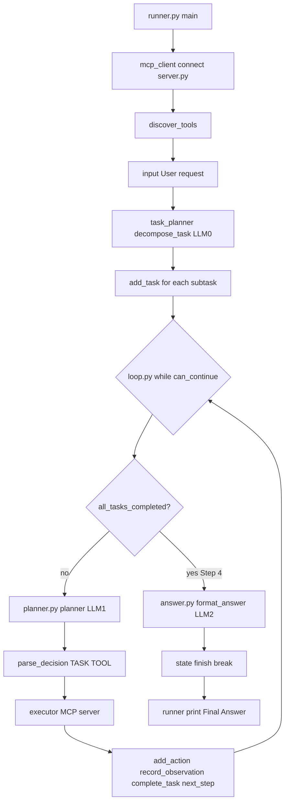
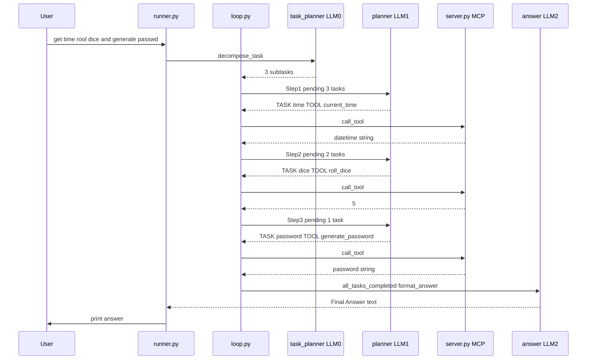

# MCP task agent loop — decompose, plan, act

Hands-on **task-aware MCP agent**: same three MCP tools as [`PROJECT_1`](../PROJECT_1/), but the run uses **three LLM roles** and a **checklist** in state before the loop spins.

| Step | LLM | File | Job |
|------|-----|------|-----|
| **0 — Decompose** | LLM #0 | [`task_planner.py`](./task_planner.py) | One user line → list of subtasks in `state["tasks"]` |
| **1 — Loop planner** | LLM #1 | [`planner.py`](./planner.py) | One pending task + one tool (`TASK:` / `TOOL:`) |
| **2 — Answer** | LLM #2 | [`answer.py`](./answer.py) | One natural sentence for the user |

**[`PROJECT_1`](../PROJECT_1/1_mcp_agent_loop.md)** = planner returns **`current_time`** or **`FINISH`** only; no task list up front.  
**This folder** = **decompose → execute each task → finish** when every task is `completed`.

Read first: [`PROJECT_1/1_mcp_agent_loop.md`](../PROJECT_1/1_mcp_agent_loop.md) · chapter [`README.md`](../README.md).

| File | Role |
|------|------|
| [`runner.py`](./runner.py) | **Entry** — MCP connect, `input`, loop, print answer |
| [`loop.py`](./loop.py) | **Control** — `while` loop, `parse_decision`, orchestration |
| [`task_planner.py`](./task_planner.py) | LLM #0 — `decompose_task` |
| [`planner.py`](./planner.py) | LLM #1 — `planner(state, tools)` |
| [`answer.py`](./answer.py) | LLM #2 — `format_answer(state)` |
| [`state.py`](./state.py) | **Memory** — tasks, actions, observations, results |
| [`executor.py`](./executor.py) | MCP call wrapper |
| [`mcp_client.py`](./mcp_client.py) | Connect / list / call / disconnect |
| [`server.py`](./server.py) | Tool implementations |

**Start with the full story:** [Real run — three tools in one request](#real-run--three-tools-in-one-request).  
**Call chain reference:** [Who calls whom](#who-calls-whom--files-and-functions).

---

## Requirements

```bash
pip install fastmcp openai python-dotenv
```

```env
OPENAI_API_KEY=your_key_here
MODEL_NAME=gpt-4o-mini
```

| Variable | Where |
|----------|--------|
| `OPENAI_API_KEY` | `task_planner.py`, `planner.py`, `answer.py` |
| `MODEL_NAME` | All three Chat Completions calls |

---

## How to run

From **`PROJECT_2`**:

```bash
python runner.py
```

You do **not** start `server.py` in a second terminal.

1. FastMCP banner + **Connected to MCP Server.** (stdio subprocess)  
2. **Available Tools** — three names from MCP `list_tools()`.  
3. Type one line at **`User :`**.  
4. Agent runs decompose + loop; debug prints show which file is active (see [Terminal map](#terminal-map-which-file-printed-what)).  
5. **Final Answer** — LLM #2 text from [`runner.py`](./runner.py).

Good stress test (three tools, three tasks):

```text
User : get time, rool dice and generate passwd
```

(Typos in the user line are fine — decomposition still yields three clear tasks.)

---

## Real run — three tools in one request

**Command:** `python runner.py` from this folder.  
**User line (your run):** `get time,rool dice and generate passwd`

Observations (time, dice value, password) will differ on your machine. The **flow** is what matters.

### Files in this run (who does what)

```text
python runner.py
        │
        ├─ mcp_client.connect()              → spawns server.py (MCP)
        ├─ discover_tools()                  → current_time, roll_dice, generate_password
        ├─ input("User : ")                  → user_request string
        │
        └─ loop.run_agent_loop(...)
                │
                ├─ create_state(user_request)
                ├─ task_planner.decompose_task   LLM #0  (once)
                ├─ add_task × 3                  → state["tasks"] all "pending"
                ├─ print Task Plan (loop.py)
                │
                └─ while can_continue(state):    max_steps = 5
                        │
                        ├─ Step 1–3: planner()   LLM #1  → TASK + TOOL
                        │            parse_decision
                        │            execute_action → MCP server.py
                        │            complete_task → status "completed"
                        │            next_step
                        │
                        └─ Step 4: all_tasks_completed
                                   → format_answer()  LLM #2
                                   → finish() → break
        │
        ├─ print state["final_answer"]
        └─ disconnect()
```



### Phase 0 — Before the loop (runner + MCP)

| What you saw | File | Function | Meaning |
|--------------|------|----------|---------|
| FastMCP banner, `Time Server` | [`server.py`](./server.py) | subprocess via stdio | MCP server process started by `Client("server.py")` |
| `Connected to MCP Server.` | [`mcp_client.py`](./mcp_client.py) | `connect()` | Client session open |
| Tool names listed | [`runner.py`](./runner.py) | `main()` | `discover_tools` → print each `tool.name` |

Deprecation warning on `Client("server.py")` is from FastMCP 4.x; the lab still works. For FastMCP 5 you would pass `pathlib.Path("server.py")`.

---

### Phase 1 — Decompose (LLM #0, once)

**Code path:** [`loop.py`](./loop.py) `run_agent_loop` → [`task_planner.py`](./task_planner.py) `decompose_task(user_request)`.

**What the model does:** Reads your messy one-liner and returns **three plain lines** (subtasks):

```text
Get the current time
Roll a dice
Generate a password
```

**What Python does after the API returns:**

1. Debug print **`inside task_planner.py file - Task Plan`** — raw model text (learning aid).  
2. Parse lines (strip `-`, `1.`, etc.) into a Python list `tasks`.  
3. Debug print **`Task Plan`** again — **parsed** list (no bullets).  
4. Back in **`loop.py`**: `add_task(state, task)` for each string → each entry is `{"task": "...", "status": "pending"}`.  
5. Print **`Task Plan`** with **`-`** prefix — canonical plan stored in state.

**Why Task Plan appears three times**

| Order | Source | Content |
|-------|--------|---------|
| 1 | `task_planner.py` | Raw LLM reply |
| 2 | `task_planner.py` | After line parsing |
| 3 | `loop.py` | From `state["tasks"]` (with `-`) |

Same three tasks each time; three different **print statements** for debugging. You can remove the extras later and keep only `loop.py`’s block.

**State after Phase 1:**

| Field | Value (conceptually) |
|-------|----------------------|
| `user_request` | `get time,rool dice and generate passwd` |
| `tasks` | 3 items, all `"status": "pending"` |
| `actions` | `[]` |
| `observations` | `[]` |
| `current_step` | `0` |

---

### Phase 2 — Step 1 (time)

**Code path:** `while` iteration → [`planner.py`](./planner.py) `planner(state, tools)`.

Before the OpenAI call, `planner` calls [`state.py`](./state.py) **`get_pending_tasks(state)`**, which prints:

```text
inside state.py file - Pending Tasks
---------
Get the current time
Roll a dice
Generate a password
```

That list is pasted into the planner prompt as **Pending Tasks** so the model knows what is still open.

**Planner Decision (LLM #1):**

```text
TASK: Get the current time
TOOL: current_time
```

**Code path after print:** [`loop.py`](./loop.py) `parse_decision` → prints **`inside loop.py file - Task and Tool`** with `Get the current time` and `current_time`.

| Step | File | What happens |
|------|------|----------------|
| Execute | [`executor.py`](./executor.py) → [`mcp_client.py`](./mcp_client.py) | `call_tool("current_time", {})` |
| Server | [`server.py`](./server.py) | `current_time()` → e.g. `01-11-2026 06:21:10` |
| Remember | [`state.py`](./state.py) | `add_action`, `record_observation`, `add_result` |
| Complete | [`state.py`](./state.py) | `complete_task(state, "Get the current time")` → first task `"completed"` |
| Advance | [`state.py`](./state.py) | `next_step` → `current_step` becomes **1** |

You see **`Observation: ...`** and **`completed`**.

**Pending tasks after Step 1:** Roll a dice, Generate a password.

---

### Phase 3 — Step 2 (dice)

Same pattern:

- **`get_pending_tasks`** prints two pending lines.  
- Planner returns `TASK: Roll a dice` / `TOOL: roll_dice`.  
- MCP runs [`server.py`](./server.py) `roll_dice()` → e.g. **`5`**.  
- `complete_task` marks **Roll a dice** completed.  
- `current_step` → **2**.

---

### Phase 4 — Step 3 (password)

- One pending task: **Generate a password**.  
- Planner → `TOOL: generate_password`.  
- MCP returns a 12-character secret (your run: `t14\F92~_"}!`).  
- Third task **completed**.  
- `current_step` → **3**.

**State before Step 4:**

| Field | After 3 tools |
|-------|----------------|
| `tasks` | All three `"completed"` |
| `actions` | `['current_time', 'roll_dice', 'generate_password']` |
| `observations` | Three dicts (step 0, 1, 2) with clock, dice, password |
| `results` | Same three strings (flat list for the planner prompt) |

---

### Phase 5 — Step 4 (finish, no MCP, no LLM #1)

**Code path:** [`loop.py`](./loop.py) top of `while` → **`all_tasks_completed(state)`** is **True**.

Python does **not** call `planner()` again. It prints:

```text
--- Step 4 ---
Planner Decision:
TASK: FINISH
```

That **`TASK: FINISH`** line is **hard-coded** in `loop.py` for clarity — it is not a fourth OpenAI planner call.

Then:

| Call | File | Role |
|------|------|------|
| `format_answer(state)` | [`answer.py`](./answer.py) | LLM #2 reads full state; writes one reply |
| `finish(state, answer)` | [`state.py`](./state.py) | Sets `final_answer`, `finished=True` |
| `break` | [`loop.py`](./loop.py) | Leaves the `while` |

[`runner.py`](./runner.py) prints **Final Answer** — your run combined time, dice **5**, and password in one sentence.



---

### Real run — one task only (`User : time`)

Same code, shorter path:

| Step | Planner / loop | MCP |
|------|----------------|-----|
| Decompose | Often **one** line: Get the current time | — |
| Step 1 | `TOOL: current_time` | Yes |
| Step 2 | `all_tasks_completed` → `TASK: FINISH` → LLM #2 | No |

Compare [`PROJECT_1` real run](../PROJECT_1/1_mcp_agent_loop.md#real-run--user--time): there the planner returns the bare string `current_time`, not `TASK:` / `TOOL:`.

---

## Terminal map — which file printed what

| Print label | File | When |
|-------------|------|------|
| `inside task_planner.py file - Task Plan` | `task_planner.py` | Right after LLM #0 responds |
| `Task Plan` (no file label) | `task_planner.py` | Parsed list |
| `Task Plan` with `-` lines | `loop.py` | After `add_task` for each subtask |
| `inside state.py file - Pending Tasks` | `state.py` | Every time `get_pending_tasks` runs (each `planner()` call) |
| `--- Step N ---` | `loop.py` | Start of each loop iteration |
| `Planner Decision:` | `loop.py` | After `planner()` or synthetic FINISH |
| `inside loop.py file - Task and Tool` | `loop.py` | After `parse_decision` |
| `Observation:` | `loop.py` | After MCP returns |
| `completed` | `loop.py` | After `complete_task` succeeds |
| `Final Answer` | `runner.py` | After loop returns |

---

## What this chapter teaches

```text
PROJECT_1                         PROJECT_2 (this folder)
────────────────────────          ─────────────────────────────────────
user_request only                 user_request + tasks[] checklist
planner → tool name or FINISH     planner → TASK line + TOOL line
stop when model says FINISH       stop when every task is completed
2 LLM roles                       3 LLM roles (decompose + plan + answer)
```

The **loop** is still: look at memory → decide → act → remember. PROJECT_2 adds an explicit **checklist** so the planner always knows which goals are still `pending`.

---

## Who calls whom — files and functions

### Entry point

| You run | Starts in | Server |
|---------|-----------|--------|
| `python runner.py` | `asyncio.run(main())` | **`server.py`** via subprocess only |

### Master table (one user request)

| # | From | Function | To | Effect |
|---|------|----------|-----|--------|
| 1 | `runner.py` | `main()` | `mcp_client` | `connect()` |
| 2 | `mcp_client.py` | `connect()` | fastmcp | spawn `server.py` |
| 3 | `runner.py` | `main()` | `mcp_client` | `discover_tools()` |
| 4 | `runner.py` | `main()` | stdin | `input()` |
| 5 | `loop.py` | `run_agent_loop()` | `state.py` | `create_state()` |
| 6 | `loop.py` | | `task_planner.py` | `decompose_task()` → `add_task()` × N |
| 7 | `loop.py` | while | `planner.py` | `planner()` → calls `get_pending_tasks()` |
| 8 | `loop.py` | | `executor.py` | `execute_action(tool, …)` |
| 9 | `executor.py` | | `mcp_client.py` | `execute_tool` → `call_tool` |
| 10 | `server.py` | `@mcp.tool` | — | tool function runs |
| 11 | `loop.py` | | `state.py` | `add_action`, `record_observation`, `add_result`, `complete_task`, `next_step` |
| 12 | `loop.py` | all done | `answer.py` | `format_answer()` |
| 13 | `loop.py` | | `state.py` | `finish()` |
| 14 | `runner.py` | `main()` | stdout | print `final_answer` |
| 15 | `runner.py` | | `mcp_client` | `disconnect()` |

### LLM #0 vs #1 vs #2

| | Function | Sees | Returns |
|---|----------|------|---------|
| **#0** | `decompose_task(user_request)` | User line only | List of task strings |
| **#1** | `planner(state, tools)` | Pending tasks, actions, observations, results, MCP tool blurbs | Two lines or `FINISH` |
| **#2** | `format_answer(state)` | Whole state summary | One user-facing paragraph |

---

## Walkthrough by file

### `state.py` — memory

| Key | Meaning |
|-----|---------|
| `tasks` | `{task, status}` — `pending` until `complete_task` |
| `actions` | Tool names already executed |
| `observations` | `{step, action, observation}` per MCP call |
| `results` | Flat strings fed back into LLM #1 |
| `current_step` | Loop counter (0-based); incremented each pass |
| `max_steps` | Default **5** — safety if planner never finishes |

`get_pending_tasks(state)` — simple loop, returns task strings still `pending`.  
`complete_task(state, task)` — matches task text loosely (case, underscores).

### `task_planner.py` — LLM #0

`decompose_task(user_request)` — one Chat Completions call; parse lines into `tasks`; fallback `[user_request]` if empty.

### `planner.py` — LLM #1

`planner(state, tools)` — builds prompt with `get_pending_tasks(state)`; expects:

```text
TASK: <exact pending task>
TOOL: <tool_name>
```

### `loop.py` — control

`parse_decision(decision)` — reads `TASK:` / `TOOL:` lines (handles one-line mistake).  
`run_agent_loop(...)` — decompose, then `while can_continue`: plan → act → remember, or exit when all tasks done.

### `answer.py` — LLM #2

`format_answer(state)` — no MCP; turns observations into natural language.

### `executor.py` / `mcp_client.py` / `server.py`

Same as PROJECT_1: MCP `call_tool` with `{}` arguments — planner cannot pass `length=` to `generate_password`.

### `runner.py`

Wires MCP + loop + prints; does not import `server.py` as a module.

---

## PROJECT_1 vs PROJECT_2

| | PROJECT_1 | PROJECT_2 |
|---|-----------|-----------|
| Pre-loop LLM | No | `decompose_task` |
| Planner output | `roll_dice` / `FINISH` | `TASK:` + `TOOL:` |
| Done condition | Model says `FINISH` | All tasks `completed` (+ optional FINISH string) |
| Answer | `runner.format_answer` | `answer.py` |

---

## Limitations

| Issue | Meaning |
|-------|---------|
| `max_steps=5` | Your three-task run used steps 1–3 + finish; a fourth tool would need headroom |
| No tool arguments | Password length always default **12** |
| Invalid `TASK:`/`TOOL:` | Burns a step; adds `"Invalid planner decision."` to `results` |
| Debug prints | Extra Task Plan blocks — optional for learning |

---

## Troubleshooting

| Symptom | Likely cause |
|---------|----------------|
| 401 | `OPENAI_API_KEY` in `.env` |
| 404 model | `MODEL_NAME` |
| Task stays pending | `complete_task` did not match planner task text, or observation started with `error` |
| Empty Final Answer | Hit `max_steps` without finishing |
| Duplicate Task Plan | Normal with current debug prints in `task_planner.py` + `loop.py` |

---

## What to remember

- **Decompose once** → **one tool per pending task** → **answer once** at the end.  
- **`get_pending_tasks`** runs inside every **LLM #1** call — that is why Pending Tasks prints before each Step 1–3.  
- **Step 4 FINISH** with no MCP means **all tasks completed**; LLM #2 still runs in **`answer.py`**.  
- MCP wiring matches PROJECT_1; what changed is **state shape** and **planner protocol**.
