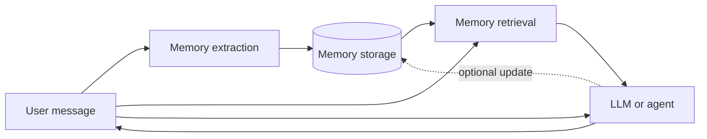

# Introduction to Memory Engineering

**Memory engineering** — chapter notes for **Souvik’s** AI learning journey (folder `21_MEMORY_ENGINEERING`).

**Memory engineering** is the practice of designing, managing, storing, and retrieving information so that an AI system can remember important context and use it intelligently in future interactions.

Think of it as building a **memory system** for AI agents and LLM applications.

By default, an LLM receives a prompt, generates an answer, and does **not** inherently retain every past conversation. Memory engineering addresses that gap.

Related earlier chapters:

- Stateless LLM calls — [`README_LLM_STATELESS_NO_MEMORY.md`](../3_LLMs_and_TOKENS/README_LLM_STATELESS_NO_MEMORY.md)
- Chat “memory” as a Python list — [`chat_conversation_memory_LLM.md`](../1_PRACTICE_ON_OLLAMA_and_OPENAI/chat_conversation_memory_LLM.md)
- RAG (external documents) — [`1_introduction_to_rag.md`](../12_RAG_Retrieval_Augmented_Generation/1_introduction_to_rag.md)
- Agent loop state dict (session memory, not long-term) — [`PROJECT_1/1_mcp_agent_loop.md`](../20_MCP_AGENT_LOOP/PROJECT_1/1_mcp_agent_loop.md)
- LangChain memory module — [`7_memory.md`](../13_LANGCHAIN/7_memory.md)

**Hands-on:** [`PROJECT_1/1_semantic_memory_lab.md`](./PROJECT_1/1_semantic_memory_lab.md) — SQLite + OpenAI embeddings + semantic search (`python test_memory.py`).  
**Agent + memory:** [`PROJECT_2/2_mcp_agent_semantic_memory.md`](./PROJECT_2/2_mcp_agent_semantic_memory.md) — MCP task loop + retrieve/save (`python runner.py`).  
**Extractor:** [`PROJECT_3/3_memory_extraction_agent.md`](./PROJECT_3/3_memory_extraction_agent.md) — PROJECT_2 + LLM fact extraction (`python test_memory_extractor.py`, `python runner.py`).

---

## Index

| # | Topic |
|---|--------|
| 1 | [Why do we need memory engineering?](#1-why-do-we-need-memory-engineering) |
| 2 | [Four types of AI memory](#2-four-types-of-ai-memory) |
| 3 | [How memory engineering works technically](#3-how-memory-engineering-works-technically) |
| 4 | [Technologies used](#4-technologies-used) |
| 5 | [Memory engineering vs RAG](#5-memory-engineering-vs-rag) |
| 6 | [Why this matters for AI agents](#6-why-this-matters-for-ai-agents) |
| 7 | [Suggested learning order](#7-suggested-learning-order) |
| 8 | [Context engineering vs memory engineering](#8-context-engineering-vs-memory-engineering) |

---

## 1. Why do we need memory engineering?

Imagine you are building an **AI personal assistant**.

You tell it over a few sessions:

- Your name and timezone.
- Your role (e.g. software engineer on a platform team).
- Tools you use daily (editor, OS, primary language).
- How you like answers (short vs detailed, code samples yes/no).
- A long-term goal you mentioned once (certification, migration project, etc.).

**Without memory**, you repeat these facts in every new chat (or paste them into every prompt).

**With memory engineering**, the system **stores** what matters, **retrieves** what is relevant for the current question, and puts that into the model’s context — so answers stay personal and consistent over time.

That is different from “the model remembered you” magically. Something **outside** the LLM (your app + storage) keeps and recalls the facts.

---

## 2. Four types of AI memory

Researchers and product teams often map AI memory to ideas from human cognition. Four common buckets:

### 1. Working memory

Information **in use right now** for this request.

| Examples |
|----------|
| Current user message |
| System prompt |
| Tool results from this turn |
| Reasoning scratchpad (chain-of-thought, agent state) |

**Layman:** the **desk** — only what you are working on at this moment.

In the MCP agent loop labs, the **`state` dict** in [`state.py`](../20_MCP_AGENT_LOOP/PROJECT_1/state.py) is **working memory for one run** — not long-term user profile storage.

### 2. Episodic memory

**Past events and interactions** — what happened, when, in what conversation or session.

| Examples |
|----------|
| “Last month the user opened a support ticket about billing.” |
| “Yesterday the agent failed deploy step 3 and retried.” |
| “In a prior session the user ran a multi-tool agent demo.” |

**Layman:** a **diary** of experiences.

### 3. Semantic memory

**Stable facts, knowledge, and preferences** — not tied to one exact timestamp.

| Examples |
|----------|
| User’s employer or team (if they chose to share it) |
| Preferred language for code samples |
| Communication style (bullets vs paragraphs) |
| Standing constraints (“no prod changes without approval”) |

**Layman:** an **encyclopedia about the user** (and about the domain the agent serves).

### 4. Procedural memory

**How to do things** — workflows, playbooks, tool order, policies.

| Examples |
|----------|
| “Deploy app: run tests → build image → push → rollout.” |
| “When user asks for time + dice, call MCP tools in task order.” |
| “Always confirm before deleting production data.” |

**Layman:** **muscle memory** for the agent — scripts and rules, not one-off chat lines.

---

## 3. How memory engineering works technically

A typical pipeline (products vary, but the idea repeats):

```text
User conversation
        │
        ▼
Memory extraction          ← LLM or rules pull facts, events, tasks, preferences
        │
        ▼
Memory storage             ← Vector DB · SQL · graph · files · cache
        │
        ▼
Memory retrieval           ← Semantic search · filters · recency · user id
        │
        ▼
LLM / AI agent             ← Prompt = working memory + retrieved memories + tools
        │
        ▼
Answer (and maybe write new memories back)
```



| Stage | Plain English |
|-------|----------------|
| **Extraction** | Decide *what* is worth remembering from this turn |
| **Storage** | Persist it with ids, timestamps, embeddings, or graph links |
| **Retrieval** | Fetch the *smallest useful slice* for the current question |
| **Generation** | Model answers using retrieved text + current message |

**Context window limit:** even with memory stores, you only inject **part** of what you stored into each call. Retrieval quality (and summarization) is the hard part.

---

## 4. Technologies used

| Technology | Purpose |
|------------|---------|
| **Redis** | Fast session / cache memory |
| **PostgreSQL** | Structured memory (users, profiles, audit rows) |
| **Pinecone** | Managed vector database |
| **ChromaDB** | Local or embedded vector storage |
| **Neo4j** | Knowledge graphs (entities and relationships) |
| **LangChain** | Memory abstractions and agent wiring |
| **LangGraph** | Stateful agent graphs, checkpoints, persistence |
| **Mem0** | Dedicated AI agent memory layer (store + retrieve + update) |

You do not need all of these at once. Many apps start with **Postgres + embeddings in a vector store**, then add graphs or Mem0 when relationships or forgetting policies matter.

---

## 5. Memory engineering vs RAG

Both **add information** to the prompt. The **intent** differs.

| | **RAG** | **Memory engineering** |
|---|---------|-------------------------|
| **Primary source** | External corpora (PDFs, wikis, tickets) | User, agent, and session-specific facts |
| **Typical focus** | Document-centric | Interaction-centric |
| **Updates** | Often ingest new docs; memories may be static per doc version | **Create, update, merge, forget** user/agent memories |
| **Example** | “Search the company handbook” | “Remember this user prefers code examples and asked for metric units last week” |

They **work together**: RAG for org knowledge, memory for **user-specific context** and **interaction history**.

| Layer | Question it answers |
|-------|---------------------|
| RAG | “What does our documentation say?” |
| Memory | “What should *this user* and *this agent* remember about past turns and preferences?” |

---

## 6. Why this matters for AI agents

Agents run **across many turns and sessions**. Each LLM call is still stateless; memory is what connects today’s run to last week’s.

**Example:** a **financial advisory agent**.

| Without memory | With memory engineering |
|----------------|-------------------------|
| Treats every chat as a first meeting | Can load prior holdings, goals, and past advice |
| Asks again for risk tolerance and horizon | Retrieves stored preferences when relevant |
| Gives generic answers | Can tie recommendations to **this user’s** history and prior decisions |

The same pattern applies to **coding agents** (repo context, past fixes), **support bots** (open tickets, prior escalations), and **internal copilots** (team conventions the user already stated).

Session-only agent state — like the `state` dict in the [MCP agent loop labs](../20_MCP_AGENT_LOOP/PROJECT_1/1_mcp_agent_loop.md) — is **working memory for one run**. Memory engineering adds **persistence across runs** (storage, retrieval, update, and sometimes forget).

---

## 7. Suggested learning order

After RAG, MCP, and agent basics, a practical path:

1. **Context engineering** — what goes into the prompt *this* turn (budget, ordering, compression)
2. **Memory engineering** — this chapter ([`PROJECT_1`](./PROJECT_1/1_semantic_memory_lab.md) storage, [`PROJECT_2`](./PROJECT_2/2_mcp_agent_semantic_memory.md) agent integration, [`PROJECT_3`](./PROJECT_3/3_memory_extraction_agent.md) extraction)
3. **Vector databases** — storage for semantic retrieval ([`6_vector_store.md`](../12_RAG_Retrieval_Augmented_Generation/6_vector_store.md))
4. **Semantic search** — embeddings + similarity ([`text_embedding_3_small.md`](../12_RAG_Retrieval_Augmented_Generation/text_embedding_3_small.md))
5. **LangGraph persistence and checkpointing** — durable agent state
6. **Mem0** — productized agent memory patterns
7. **Long-term memory for autonomous agents** — episodic + semantic systems at scale

---

## 8. Context engineering vs memory engineering

| | **Context engineering** | **Memory engineering** |
|---|-------------------------|-------------------------|
| **Horizon** | **Now** — this request’s prompt | **Over time** — store and recall across sessions |
| **Question** | “What do we put in the window *right now*?” | “What do we **keep**, **update**, and **retrieve** later?” |
| **Tools** | Prompt templates, trimming, RAG chunk pick, tool output shaping | Extraction, DBs, graphs, forgetting, user profiles |

**One line:** context engineering **fills the desk**; memory engineering **runs the filing cabinet** and decides what to pull onto the desk next time.

---

## What to remember

- LLMs are **stateless** unless **your application** remembers for them.
- **Working / episodic / semantic / procedural** memory are useful mental models for design.
- **RAG ≠ memory** — complementary, not interchangeable.
- Agent **state dicts** (MCP loop) are **session working memory**, not a full memory product.
- [`PROJECT_2`](./PROJECT_2/2_mcp_agent_semantic_memory.md) shows **retrieve before** the loop and **save after** finish — persistence across runs.
- [`PROJECT_3`](./PROJECT_3/3_memory_extraction_agent.md) adds **what to remember** — extractor LLM + `save_semantic_memory`.
