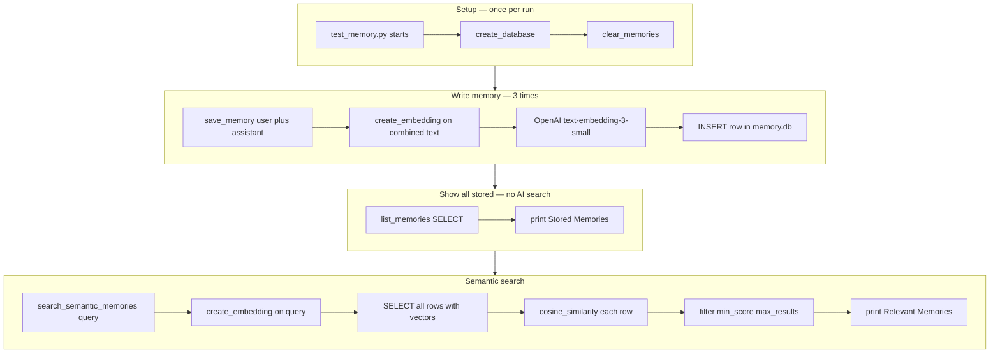
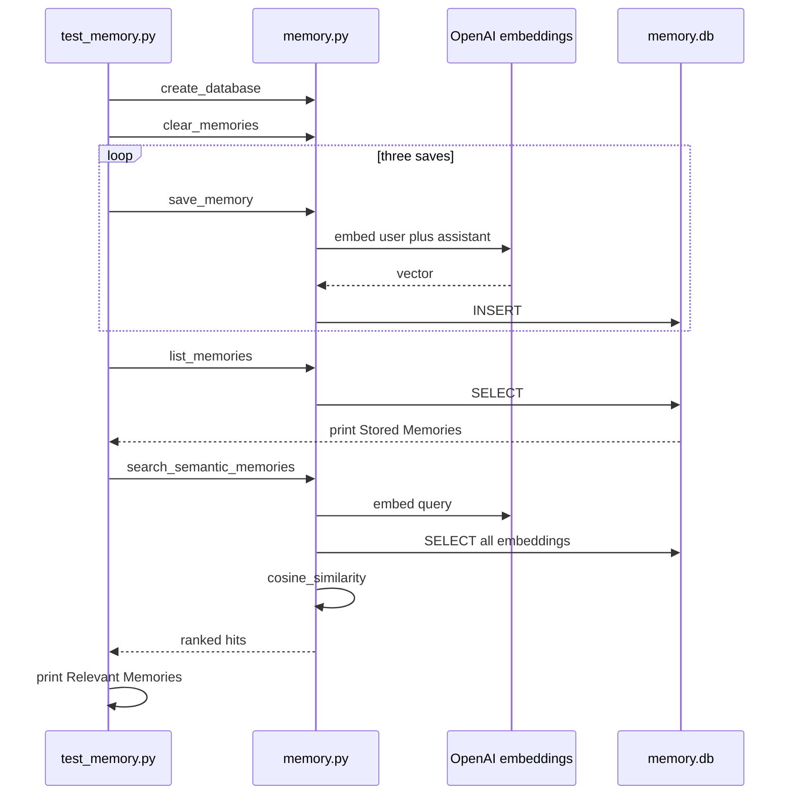

# Semantic memory lab — SQLite + embeddings

Hands-on **memory storage and retrieval**: each conversation turn is saved in **SQLite** with an **embedding vector**. A later question **searches by meaning** (cosine similarity), not by matching exact words.

**Theory:** [`1_introduction_to_memory_engineering.md`](../1_introduction_to_memory_engineering.md)  
**Math:** [`cosine_similarity.md`](../../12_RAG_Retrieval_Augmented_Generation/cosine_similarity.md)  
**Embeddings:** [`text_embedding_3_small.md`](../../12_RAG_Retrieval_Augmented_Generation/text_embedding_3_small.md)

| File | Role |
|------|------|
| [`memory.py`](./memory.py) | Library — database, embed, save, list, search |
| [`test_memory.py`](./test_memory.py) | **Run this** — demo script (top to bottom) |
| `memory.db` | SQLite file (created in **`PROJECT_1`** when you run the script) |

**Start with your terminal output:** [Real run — `python test_memory.py`](#real-run--python-test_memorypy).

---

## Index

| # | Topic |
|---|--------|
| 1 | [Why embeddings are needed](#why-embeddings-are-needed-here) |
| 2 | [Flow diagram — full pipeline](#flow-diagram--full-pipeline) |
| 3 | [Each function — why it exists](#each-function--why-it-exists-utility) |
| 4 | [Search logic — min_score and max_results](#search-logic--min_score-max_results-and-the-loop) |
| 5 | [Requirements](#requirements) |
| 6 | [How to run](#how-to-run) |
| 7 | [Real run — `python test_memory.py`](#real-run--python-test_memorypy) |
| 8 | [Call chain (one picture)](#call-chain-one-picture) |
| 9 | [Line by line — `test_memory.py`](#line-by-line--test_memorypy) |
| 10 | [Line by line — `memory.py`](#line-by-line--memorypy) |
| 11 | [Who calls whom](#who-calls-whom) |
| 12 | [Limits and troubleshooting](#limits-and-troubleshooting) |

---

## Why embeddings are needed here

An LLM **does not remember** past runs. This lab **stores** turns in SQLite. When the user later asks something new, you must **find** the right old turns to put back into a prompt.

### Keyword search is not enough

| Stored text | New question | Keyword match? |
|-------------|--------------|----------------|
| `My name is Souvik.` | `What is my name` | **No** — different words |
| `I am learning Python.` | `What language am I studying` | **No** — no shared tokens |

You need **meaning**, not spelling overlap.

### What an embedding does

```text
"My name is Souvik."  →  [0.02, -0.01, 0.08, ...]   (1536 numbers)
"What is my name"     →  [0.03, -0.02, 0.07, ...]   (similar direction)
"I am learning MCP."  →  [different direction]       (less similar)
```

The embedding model maps text into a **vector space** where **similar meaning** → **similar vectors**.  
You store the vector at **save** time. At **search** time you embed the **query** and ask: *which stored vectors point the same way?*

That is **semantic memory retrieval** — the same core idea as RAG chunk search, but rows are **chat turns** instead of PDF chunks.

Without embeddings you would only have:

- `LIKE '%name%'` in SQL — misses paraphrases  
- Resend **all** history every call — blows the context window  

Embeddings let you retrieve **a few relevant rows** for **this** question.

---

## Flow diagram — full pipeline



Plain-text version (same story):

```text
test_memory.py
    │
    ├─ create_database()     WHY: table must exist before INSERT
    ├─ clear_memories()      WHY: demo starts empty (no duplicate rows)
    │
    ├─ save_memory × 3
    │     ├─ create_embedding()   WHY: turn text → vector for later search
    │     └─ SQLite INSERT        WHY: persist text + vector on disk
    │
    ├─ list_memories()       WHY: human-readable proof of what is stored
    │
    └─ search_semantic_memories("What is my name")
          ├─ create_embedding(query)   WHY: query in same vector space as saves
          ├─ cosine_similarity()       WHY: score how related each memory is
          └─ min_score + max_results      WHY: return best matches, not everything
```

---

## Each function — why it exists (utility)

### In [`memory.py`](./memory.py)

| Function | Utility (what job it does) | Why you need it |
|----------|----------------------------|-----------------|
| **`create_database()`** | Creates the **`memories`** table if missing. | SQLite has nowhere to store rows until the schema exists. Safe to call every run (`IF NOT EXISTS`). |
| **`clear_memories()`** | `DELETE FROM memories`. | Demo script resets content so you do not stack duplicate Souvik rows when re-running `test_memory.py`. (Production apps would **not** wipe all memory each time.) |
| **`create_embedding(text)`** | Calls OpenAI **`text-embedding-3-small`** → list of floats. | **Central step for semantic memory.** Turns language into numbers you can compare. Used when **saving** (turn text) and when **searching** (query text). |
| **`cosine_similarity(v1, v2)`** | One number: how aligned two vectors are. | Embeddings alone do not say “match”; you need a **score**. Cosine is standard for text embeddings (see topic 12). |
| **`save_memory(user, assistant)`** | Embed `user + "\n" + assistant`, **INSERT** one row. | **Write path** for memory engineering: capture a turn + its meaning vector for later retrieval. |
| **`list_memories()`** | `SELECT` id, messages, time — **no** embeddings in the result. | **Inspect** what is on disk (your **Stored Memories** block). Debugging and UI; not used for ranking. |
| **`search_semantic_memories(query, max_results, min_score)`** | Embed query, score every row, filter, sort, return best. | **Read path**: answer *“what past turns relate to this question?”* — the heart of the lab. |

Optional **print** lines inside [`memory.py`](./memory.py) (e.g. “Embedding created successfully”) are **learning traces** — they show which function ran; you can remove them later.

### In [`test_memory.py`](./test_memory.py)

| Part | Utility |
|------|---------|
| **`load_dotenv` + API key check** | Fail fast if `.env` is wrong — embeddings never run without a key. |
| **Three `save_memory(...)` lines** | Seed fake “conversation history” (name, Python, MCP). |
| **`list_memories` loop** | Prove saves worked before search. |
| **`search_semantic_memories("What is my name")`** | Demonstrate **paraphrase** retrieval (question ≠ stored sentence). |
| **Print loops** | Show **score** so you see similarity is numeric, not magic. |

### How the functions chain in your sample run

| Step | Function | Your output |
|------|----------|-------------|
| 1 | `save_memory` × 3 | Rows 7–9 in DB (after embed API calls) |
| 2 | `list_memories` | **Stored Memories** — all three turns |
| 3 | `search_semantic_memories` | **Relevant Memories** — mainly the Souvik turn (~0.35) |
| Not called for ranking | `list_memories` | Does **not** pick “relevant” — only lists everything |

**`create_embedding`** runs **4 times** in one demo run: 3 saves + 1 search query.

---

## Search logic — min_score, max_results, and the loop

`search_semantic_memories(query, max_results=3, min_score=0.20)` does **not** return “the three closest rows no matter what.” It runs a **two-stage filter**: first **quality** (`min_score`), then **how many** (`max_results`).

**Naming:** Both are **your Python parameters**, not OpenAI fields. RAG docs often say **`top_k`** instead of `max_results` and **`threshold`** instead of `min_score` — same ideas.

### Pipeline inside search

```text
query  →  create_embedding(query)  →  query_embedding
              ↓
SELECT user_message, assistant_message, embedding, created_at FROM memories
              ↓
for each row:
    memory_embedding = json.loads(embedding_json)
    score = cosine_similarity(query_embedding, memory_embedding)
    if score >= min_score:            ← gate: drop weak matches
        append { user_message, assistant_message, created_at, score }
              ↓
sort results by score (highest first)
              ↓
return results[:max_results]        ← cap count after filter
```

### What `if score >= min_score:` means

| Idea | Detail |
|------|--------|
| **Cosine score** | Roughly “how aligned are the two vectors?” — higher = more similar **meaning**. |
| **`min_score=0.20`** | Only rows with **score ≥ 0.20** enter `results`. Rows below are **ignored** for retrieval (they never appear in **Relevant Memories**). |
| **Why not only `max_results`?** | Without a minimum score, unrelated turns can still rank in the “top 3” with low values (e.g. 0.14). The gate keeps junk out of agent context. |
| **`max_results=3`** | After filtering and sorting, return **at most** three hits — even if more rows passed `min_score`. |

### Real scores from `python test_memory.py` (query: `"What is my name"`)

Your debug prints (`for user message:` / `score:`) run **once per stored row**, **after** each `cosine_similarity` call:

| Stored user turn | Printed `score` | `score >= 0.20`? | In final `results`? |
|------------------|-----------------|------------------|---------------------|
| My name is Souvik. | ~**0.354** | Yes | **Yes** (only hit in this run) |
| I am learning Python. | ~**0.142** | No | No |
| I am learning about MCP. | ~**0.158** | No | No |

So **Relevant Memories** shows one row (~0.35), not three — because **two rows failed `min_score`**, not because `max_results` was 1.

### Why `min_score=0.20` — not 1, 2, or 100?

Cosine similarity is **not** a percent grade and **not** “how many matches.” It is always in a **fixed math range**:

| Range | Meaning |
|-------|---------|
| **−1 to +1** | Theoretical min/max for any two vectors (same direction → **+1**, opposite → **−1**). |
| **Typical embedding pairs** | Unrelated chat turns often land around **0.1–0.2**; related / paraphrase pairs often **0.3–0.7** (your name hit ~**0.35**). |

So:

| If you set `min_score` to… | What happens in practice |
|----------------------------|---------------------------|
| **0.20** (lab default) | Drops obvious noise (~0.14 Python) but keeps “What is my name?” → “My name is Souvik.” |
| **1** | Would require **perfect** alignment. Real paraphrases almost never reach 1.0 — you would usually get **zero** memories. |
| **2 or 100** | **Invalid** for cosine similarity. Scores cannot exceed **1**; the check would never pass (or would be meaningless). |
| **0** | Everything passes the gate; `max_results` alone decides — weak unrelated rows can slip into context. |

**0.20 is a demo default**, not a universal law. You tune it by running searches and reading printed **`score:`** lines. Lower → more recall; higher → stricter precision.

**Theory:** [`cosine_similarity.md`](../../12_RAG_Retrieval_Augmented_Generation/cosine_similarity.md)

### Tuning knobs

| Change | Effect |
|--------|--------|
| Lower `min_score` (e.g. `0.10`) | More rows can pass; Python/MCP might appear with low scores. |
| Raise `min_score` (e.g. `0.40`) | Stricter; even the name turn might drop if paraphrase score falls. |
| Raise `max_results` | More rows **among those that passed** `min_score`; useless if only one row passes. |

### Debug print order (search loop)

For **each** row from SQLite, console order matches `memory.py`:

1. `Function cosine_similarity() - Cosine similarity calculated successfully`
2. `for user message: …`
3. `score: …` (often `numpy.float64`)
4. If step 3 ≥ `min_score`, row is appended (no extra print)

After the loop: success line, then `Results:` with the list passed to `return results[:max_results]`.
---

## Requirements

```bash
pip install openai python-dotenv numpy
```

`.env` (repo root; `load_dotenv()` finds it):

```env
OPENAI_API_KEY=your_key_here
```

| Item | This lab |
|------|----------|
| API | OpenAI cloud (default base URL) |
| Embedding model | `text-embedding-3-small` in [`memory.py`](./memory.py) |
| Chat `MODEL_NAME` | **Not used** — no answer LLM yet |

---

## How to run

From **`PROJECT_1`**:

```bash
python test_memory.py
```

The script runs **top to bottom** (no `if __name__` block). You should see **Stored Memories** (all rows), then **Relevant Memories** (semantic search hits).

---

## Real run — `python test_memory.py`

This section matches a **real** run of the current code (including your **debug prints** in [`memory.py`](./memory.py)). For **why** only one row lands in **Relevant Memories**, read [Search logic — min_score, max_results, and the loop](#search-logic--min_score-max_results-and-the-loop). Ids and timestamps change each run; **function print order** stays the same.

### Terminal output (abbreviated)

`print(rows)` at line 107 of [`memory.py`](./memory.py) is **one** `print` call. Python prints the **whole list** of three SQL tuples on **a single terminal line** (~90k+ characters — mostly embedding JSON). The doc shows that as one omitted line.

Fresh run example (2026-11-01; **ids increase** each time you run because of `AUTOINCREMENT`):

```text
Function create_database() - Database created successfully

Function clear_memories() - Memories cleared successfully

Function create_embedding() - Embedding created successfully
Function save_memory() - Memory saved successfully

Function create_embedding() - Embedding created successfully
Function save_memory() - Memory saved successfully

Function create_embedding() - Embedding created successfully
Function save_memory() - Memory saved successfully

Stored Memories
-----------------

Function list_memories() - Memories listed successfully

[22] 2026-11-01 10:57:04
User: My name is Souvik.
Assistant: Nice to meet you, Souvik.

[23] 2026-11-01 10:57:05
User: I am learning Python.
Assistant: Python is useful for AI development.

[24] 2026-11-01 10:57:05
User: I am learning about MCP.
Assistant: MCP allows AI applications to use tools.

Function create_embedding() - Embedding created successfully

Function search_semantic_memories() - Searching semantic memories...
Query: What is my name
Max results: 3
Min score: 0.2
[('My name is Souvik.', 'Nice to meet you, Souvik.', '<embedding JSON ~1536 floats>', '2026-11-01 10:57:04'), ('I am learning Python.', ...), ('I am learning about MCP.', ...)]   ← ONE long line omitted in practice

Function cosine_similarity() - Cosine similarity calculated successfully

for user message:  My name is Souvik.
score:  0.3543710407942775

Function cosine_similarity() - Cosine similarity calculated successfully

for user message:  I am learning Python.
score:  0.14180545980054482

Function cosine_similarity() - Cosine similarity calculated successfully

for user message:  I am learning about MCP.
score:  0.15799294289487298

Function search_semantic_memories() - Semantic memories searched successfully

Function search_semantic_memories() - Results:
[{'user_message': 'My name is Souvik.', 'assistant_message': 'Nice to meet you, Souvik.', 'created_at': '2026-11-01 10:57:04', 'score': np.float64(0.3543710407942775)}]

Relevant Memories
-----------------

Score: 0.3543710407942775
User: My name is Souvik.
Assistant: Nice to meet you, Souvik.
```

### Print line → function (in order)

| # | What you see | Where | Why it prints |
|---|--------------|--------|----------------|
| 1 | `create_database() - Database created successfully` | `memory.py` | End of `create_database()` |
| 2 | `clear_memories() - Memories cleared successfully` | `memory.py` | End of `clear_memories()` |
| 3–8 | Pairs of `create_embedding()` then `save_memory()` × **3** | `memory.py` | Each `save_memory` calls `create_embedding` then prints saved |
| 9 | Header `Stored Memories` | `test_memory.py` | Before listing rows |
| 10 | `list_memories() - Memories listed successfully` | `memory.py` | After SQL SELECT |
| 11–13 | `[id] timestamp` + User / Assistant × **3** | `test_memory.py` | Loop over `list_memories()` |
| 14 | `create_embedding()` once more | `memory.py` | Embed the **search query** |
| 15–18 | `Searching...` / `Query` / `Max results` / `Min score` | `memory.py` | Start of search loop setup |
| 19 | **`print(rows)`** — **one** ~90k character line (3 tuples + embeddings) | `memory.py` line 107 | Raw fetchall before the loop |
| 20–28 | Per row × **3**: `cosine_similarity()` → `for user message:` → `score:` | `memory.py` lines 109–114 | See [Search logic](#search-logic--min_score-max_results-and-the-loop); only scores **≥ min_score** are appended |
| 29–30 | `Semantic memories searched successfully` + `Results:` list | `memory.py` | Python list of dicts that passed **`min_score`** |
| 31–33 | `Relevant Memories` + Score / User / Assistant | `test_memory.py` | Final user-facing slice (`results[:max_results]`) |

**Note:** **3** loop iterations = **3** cosine lines and **3** score lines. Python (~**0.14**) and MCP (~**0.16**) print scores but **fail** `score >= 0.20`, so `Results` and **Relevant Memories** show only Souvik (`score` may display as `np.float64(...)` in the list print).

### What each main block means

| Block | Meaning |
|-------|---------|
| **Function … successfully** lines | Your tracing prints — prove call order while learning. |
| **Stored Memories** | All rows in the DB right now (after `clear` + 3 saves). |
| **`[22]` … `[24]`** (example) | SQLite ids; **`AUTOINCREMENT` does not reset** when you `DELETE` — next run might be `[25]` `[26]` `[27]`. |
| **`print(rows)`** | One massive line; comment out line 107 when you no longer need it. |
| **Results: `[{... np.float64(0.354...) }]`** | Dicts that passed **`min_score`** (NumPy type in repr is normal). |
| **Relevant Memories** | `test_memory.py` prints the same hit with a plain float score. |

### Phases in order

```text
Phase A   load .env, check API key          (test_memory.py — no print)
Phase B   create_database + clear_memories  → 2 success lines
Phase C   save_memory × 3                   → 6 lines (embed + save each)
Phase D   list_memories + Stored Memories   → 1 list line + 3 entries
Phase E   search_semantic_memories          → embed, search debug, print(rows),
            per-row cosine + score prints, Results list, Relevant Memories
```



---

## Call chain (one picture)

```text
python test_memory.py
    │
    ├─ load_dotenv() / OPENAI_API_KEY check
    ├─ create_database()     → CREATE TABLE IF NOT EXISTS
    ├─ clear_memories()      → DELETE FROM memories
    │
    ├─ save_memory × 3
    │       └─ memory.py: create_embedding → INSERT
    │
    ├─ list_memories()       → SELECT → print "Stored Memories"
    │
    └─ search_semantic_memories("What is my name")
            └─ embed query → SELECT all → cosine → print "Relevant Memories"
```

---

## Line by line — `test_memory.py`

| Line | Code | What it does |
|------|------|----------------|
| 1 | `import os` | Used to read `OPENAI_API_KEY`. |
| 3–4 | `load_dotenv` / `from memory import *` | Load `.env`; import all helpers from [`memory.py`](./memory.py). |
| 6 | `load_dotenv()` | Second load in script (harmless); ensures env before check. |
| 8–9 | `if not os.getenv(...)` | Exit early with a clear message if the key is missing. |
| 11 | `create_database()` | Ensures table **`memories`** exists in `memory.db`. |
| 12 | `clear_memories()` | **Deletes all rows** so this demo run does not duplicate old saves. |
| 14–16 | three `save_memory(...)` | Each line stores one **user + assistant** turn and its embedding. |
| 18–19 | print header | Label for the next section. |
| 20–23 | `for entry in list_memories()` | Reads **every** row from SQLite (no similarity yet) and prints id, time, messages. |
| 25 | `search_semantic_memories("What is my name")` | Embeds the **question**, compares to **all** stored embeddings, returns ranked hits. |
| 27–28 | print header | Label for search results. |
| 30–33 | `for result in results` | Prints **score** (cosine similarity) plus the matched user/assistant text. |

---

## Line by line — `memory.py`

### Module setup (lines 1–13)

| Lines | What |
|-------|------|
| 1–7 | Imports: `json`, `os`, `sqlite3`, `numpy`, `dotenv`, `OpenAI`. |
| 9 | `load_dotenv()` | Loads **`OPENAI_API_KEY`** from `.env`. |
| 11 | `DATABASE = "memory.db"` | File name; created in the **current working directory** (run from **`PROJECT_1`**). |
| 13 | `embedding_client = OpenAI(...)` | Client for **`embeddings.create`** only (not chat). |

### `create_database()` (lines 16–29)

| Step | Effect |
|------|--------|
| `sqlite3.connect(DATABASE)` | Open (or create) the file. |
| `CREATE TABLE IF NOT EXISTS memories` | Columns: `id`, `user_message`, `assistant_message`, `embedding` (JSON text), `created_at`. |
| `commit` / `close` | Persist and release connection. |

### `clear_memories()` (lines 32–37)

| Step | Effect |
|------|--------|
| `DELETE FROM memories` | Empty the table for a clean demo run. |
| Does **not** reset `AUTOINCREMENT` | Next ids may be 7, 8, 9 like in your run. |

### `create_embedding(text)` (lines 40–42)

| Step | Effect |
|------|--------|
| `embeddings.create(model="text-embedding-3-small", input=text)` | HTTP call to OpenAI; returns ~1536 floats. |
| `return ...embedding` | Python list of numbers stored later as JSON. |

### `cosine_similarity(vector1, vector2)` (lines 45–48)

| Step | Effect |
|------|--------|
| NumPy arrays | Same math as topic 12 RAG notes. |
| Return value | **~1** = very similar direction; **~0** = unrelated; your name hit **~0.35** = related but not identical wording. |

### `save_memory(user_message, assistant_message)` (lines 51–64)

| Step | Effect |
|------|--------|
| `text = user + "\n" + assistant` | One string embedded so retrieval sees **both** sides of the turn. |
| `create_embedding(text)` | OpenAI call **per save** (three API calls in the demo). |
| `INSERT ... VALUES (?, ?, ?)` | Stores plain text + `json.dumps(embedding)`. |

### `list_memories()` (lines 67–80)

| Step | Effect |
|------|--------|
| `SELECT id, user_message, assistant_message, created_at` | Does **not** load embeddings (smaller, readable print). |
| `ORDER BY id` | Stable order for **Stored Memories**. |
| Returns list of dicts | Used by the print loop in `test_memory.py`. |

### `search_semantic_memories(query, max_results=3, min_score=0.20)` (lines 92–127)

| Lines | Step | Effect |
|-------|------|--------|
| 93 | `query_embedding = create_embedding(query)` | Same model as save — query and memories share one vector space. |
| 96–107 | `SELECT` all rows with embeddings + debug prints | Full table scan; `print(rows)` dumps **one** long line. |
| 109–121 | `for` each row | `json.loads` → `score = cosine_similarity(...)` → print user message + score → **`if score >= min_score:`** append dict. |
| 122 | `results.sort(..., reverse=True)` | Highest similarity first among **survivors** of the `min_score` gate. |
| 125–127 | Print `Results`, `return results[:max_results]` | At most **`max_results`** dicts returned to `test_memory.py`. |

Full narrative: [Search logic — min_score, max_results, and the loop](#search-logic--min_score-max_results-and-the-loop).

---

## Who calls whom

| Order | Caller | Function | Callee / system | Result |
|-------|--------|----------|-----------------|--------|
| 1 | `test_memory.py` | `create_database` | `memory.py` → SQLite | Table ready |
| 2 | `test_memory.py` | `clear_memories` | `memory.py` → SQLite | Empty table |
| 3 | `test_memory.py` | `save_memory` | `create_embedding` → OpenAI | 3 new rows |
| 4 | `test_memory.py` | `list_memories` | SQLite SELECT | Printed stored list |
| 5 | `test_memory.py` | `search_semantic_memories` | OpenAI + cosine loop | Printed relevant list |

---

## Limits and troubleshooting

| Topic | Detail |
|-------|--------|
| No answer LLM | You only **retrieve**; next lab step is inject hits + `MODEL_NAME`. |
| Full table scan | Use Chroma / pgvector at scale ([`6_vector_store.md`](../../12_RAG_Retrieval_Augmented_Generation/6_vector_store.md)). |
| **`min_score`** | Lower `min_score` in `search_semantic_memories(...)` to see more hits; raise it to be stricter. See [Why `min_score=0.20`?](#why-min_score020--not-1-2-or-100) in Search logic. |
| ids 7, 8, 9 | Normal after **`clear_memories`** many times; delete `memory.db` to reset ids. |
| Duplicate relevant rows | Should not happen if **`clear_memories()`** runs each time; if you remove it, old rows stack up. |
| 401 | Fix **`OPENAI_API_KEY`** in `.env`. |
| Wrong folder | Run from **`PROJECT_1`** so `memory.db` sits beside the scripts. |

---

## What to remember

- **`save_memory`** = write episodic turn + semantic vector.  
- **`list_memories`** = show everything stored (debug / UI).  
- **`search_semantic_memories`** = retrieve what **means** similar to the query.  
- Your run proved: *“What is my name”* pulls the **Souvik** turn, not exact keyword match.  
- Next step: pass **Relevant Memories** into a chat prompt — memory-augmented generation.
