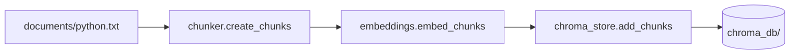
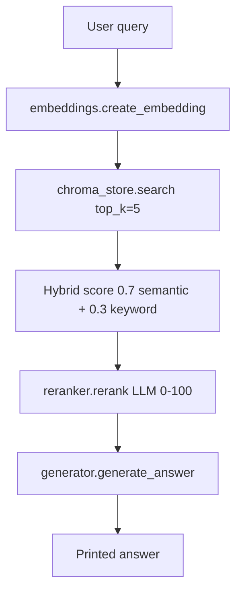

# Advanced RAG project — full flow

Python project in this folder (chapter `22_ADVANCED_RAG_HYBRID_SEARCH_RE-RANK_FAISS`).

Learn the two retrieval ideas separately first:

- [`../PROJECT_SEMANTIC_SEARCH/`](../PROJECT_SEMANTIC_SEARCH/) — cosine + embeddings only  
- [`../PROJECT_KEYWORD_SEARCH/`](../PROJECT_KEYWORD_SEARCH/) — word overlap only  

This pipeline **combines** them (0.7 semantic + 0.3 keyword) plus Chroma, rerank, and answer. It is **not** the tiny FAISS demo from [`1_what_is_faiss.md`](../1_what_is_faiss.md). Here you run a **full RAG loop** with:

- **Chroma** for persisted vector search (like topic **13**, but native `chromadb` here)
- **Hybrid retrieval** — semantic (vectors) + keyword overlap
- **LLM re-ranking** — a small local model scores each candidate chunk
- **LLM generation** — answer from the top chunks only

**Prerequisites (earlier chapters):**

- RAG ideas — [`12_RAG_Retrieval_Augmented_Generation/`](../../12_RAG_Retrieval_Augmented_Generation/)
- LangChain + Chroma practice — [`13_LANGCHAIN/`](../../13_LANGCHAIN/) (`vector_db/` there is a **separate** DB from this project’s `./chroma_db/`)
- Cosine / hybrid intuition — [`cosine_similarity.md`](../../12_RAG_Retrieval_Augmented_Generation/cosine_similarity.md)

---

## Index

| # | Section |
|---|---------|
| 1 | [Directory layout](#1-directory-layout) |
| 2 | [End-to-end flow (build + chat)](#2-end-to-end-flow-build--chat) |
| 3 | [Phase A — ingest (`build_rag`)](#3-phase-a--ingest-build_rag) |
| 4 | [Phase B — retrieve (`retrieve`)](#4-phase-b--retrieve-retrieve) |
| 5 | [Phase C — generate (`generate_answer`)](#5-phase-c--generate-generate_answer) |
| 6 | [File-by-file map](#6-file-by-file-map) |
| 7 | [Ollama models used](#7-ollama-models-used) |
| 8 | [How to run](#8-how-to-run) |
| 9 | [What is wired vs unused](#9-what-is-wired-vs-unused) |
| 10 | [FAISS vs this project](#10-faiss-vs-this-project) |

---

## 1. Directory layout

```text
project/                          ← run python main.py from here
├── advanced_rag_project_flow.md  ← this note
├── main.py                       ← entry: build index + REPL
├── advanced_rag.py               ← build_rag + retrieve (orchestration)
├── chunker.py
├── embeddings.py
├── chroma_store.py
├── retriever.py
├── reranker.py
├── generator.py
├── evaluation.py
└── chroma_db/                    ← created at runtime

**Knowledge (chapter level, shared):** [`../documents/`](../documents/)

| File | Topic |
|------|--------|
| `kubernetes.txt` | K8s |
| `python.txt` | Python |
| `cpp.txt` | C++ |

**Chunking:** off for now — `build_rag(..., chunk=False)` stores **one vector per file**. Later set `chunk=True` to use `chunker.py`.
```

---

## 2. End-to-end flow (build + chat)

### Build (once per run of `main.py`)



### Each user question



**Layman version:**

1. **Split** the doc into overlapping word windows.
2. **Embed** each chunk with OpenAI (`text-embedding-3-small`).
3. **Save** vectors + text in **Chroma** on disk.
4. On a question: **find** similar chunks in Chroma, **blend** vector match with **keyword** match, **re-score** top items with an LLM, then **answer** using only those chunks.

---

## 3. Phase A — ingest (`build_rag`)

Called from `main.py` before the chat loop.

| Step | Function | What happens |
|------|-----------|----------------|
| 1 | `create_chunks(text, source, chunk_size=200, overlap=50)` | Split on **words** (not characters). Step forward by `200 - 50 = 150` words so chunks overlap. Each chunk gets `source` (filename) and `chunk_id`. |
| 2 | `embed_chunks(chunks)` | For each chunk, OpenAI `text-embedding-3-small` (same as topic 12 / 21 memory). |
| 3 | `add_chunks(embedded_chunks)` | `collection.upsert` into Chroma collection `"documents"` under `./chroma_db`. IDs like `python.txt_0`, metadata stores `source` + `chunk_id`. |

**Code path:** `main.py` → `advanced_rag.build_rag` → `chunker` → `embeddings` → `chroma_store`.

---

## 4. Phase B — retrieve (`retrieve`)

| Step | What happens |
|------|----------------|
| 1 | Embed the **query** (same model as chunks). |
| 2 | `chroma_search(query_embedding, top_k=5)` — Chroma returns `documents`, `metadatas`, `distances`. |
| 3 | For each hit: **semantic** = `1 / (1 + distance)` (higher = closer in Chroma’s distance metric). |
| 4 | **keyword** = `keyword_score(query, text)` — fraction of query words that appear in the chunk (set overlap / \|query words\|). |
| 5 | **combined** = `0.7 * semantic + 0.3 * keyword`. Sort by `combined_score`, keep top 5. |
| 6 | `rerank(query, candidates, top_k=3)` — for **each** candidate, `OPENAI_MODEL` returns a relevance score 0–100; keep top **3** for generation. |

`main.py` prints **“Retrieved Sources Ranking”** from the **final** reranked list (top 3). You also see **“Retrieved Sources Candidates”** inside `retrieve()` (hybrid top 5) before rerank.

**Code path:** `main.py` → `advanced_rag.retrieve` → `embeddings` + `chroma_store` + `retriever.keyword_score` + `reranker`.

---

## 5. Phase C — generate (`generate_answer`)

| Input | Top 3 chunks after rerank (dicts with `text`, `source`, `chunk_id`, scores). |
|-------|----------------|
| Prompt | Context = joined chunk texts. Rules: use only context, no invention, say if missing. |
| Model | `OPENAI_MODEL` from `.env` (chat completions). |
| Output | String printed as `RAG :`. |

**Code path:** `main.py` → `generator.generate_answer`.

---

## 6. File-by-file map

| File | Role |
|------|------|
| **`main.py`** | Read `documents/python.txt`, call `build_rag`, then REPL: `retrieve` → print sources → `generate_answer`. Exit on `quit` / `exit`. |
| **`advanced_rag.py`** | **`build_rag`** (ingest pipeline) and **`retrieve`** (Chroma + hybrid + rerank). This is the “brain” wiring. |
| **`chunker.py`** | Simple word-window chunker with overlap. |
| **`embeddings.py`** | `OPENAI_API_KEY` + **`text-embedding-3-small`**. |
| **`chroma_store.py`** | `PersistentClient(path="./chroma_db")`, collection **`documents`**. `upsert` on ingest, `query` on search. |
| **`retriever.py`** | **`keyword_score`**, plus **`semantic_search`** / **`hybrid_search`** over an in-memory `chunks` list — used in teaching-style code, **not** called by `advanced_rag.py` today (orchestrator uses Chroma + inline hybrid). |
| **`reranker.py`** | One LLM call per candidate; parse float score; sort; return top 3. |
| **`generator.py`** | Grounded QA prompt over retrieved context. |
| **`evaluation.py`** | `evaluate_retrieval(results, expected_chunk_id)` — checks if an expected chunk id appears; **not** imported by `main.py`. |

---

## 7. OpenAI / `.env`

Same pattern as the rest of `AI_LEARNING` (repo root `.env`, gitignored):

```env
OPENAI_API_KEY=your_key_here
OPENAI_MODEL=gpt-4.1-nano
```

| Setting | Used in | Purpose |
|---------|---------|---------|
| **`text-embedding-3-small`** (constant in `embeddings.py`) | `embeddings.py` | Chunk + query embeddings — must stay consistent for Chroma search. |
| **`OPENAI_MODEL`** | `reranker.py`, `generator.py` | Relevance scoring + final answer. |

Scripts load `AI_LEARNING/AI_LEARNING/.env` when you run from `project/` (path resolved via `Path(__file__).parents[2]`).

---

## 8. How to run

**Install (once per env):**

```bash
pip install chromadb openai numpy python-dotenv
```

**Prepare data:** create `documents/python.txt` in this folder with any text you want to query.

**Run from this folder:**

```bash
python main.py
```

First run builds embeddings and writes **`./chroma_db/`**. Later runs **upsert** again (same source may update ids).

Type questions at `You :`. Type `quit` or `exit` to leave.

**Tips:**

- If retrieval looks wrong, delete `chroma_db/` and rebuild after changing the embedding model.
- Topic **13** Chroma lives at `13_LANGCHAIN/vector_db/` — **different folder**, different collection purpose.

---

## 9. What is wired vs unused

| Piece | Wired in `main.py`? |
|-------|---------------------|
| Chroma persist + query | Yes |
| Hybrid (semantic + keyword) in `retrieve` | Yes |
| LLM reranker | Yes |
| LLM generator | Yes |
| `retriever.semantic_search` / `hybrid_search` (in-memory) | No — alternate path if you skip Chroma |
| `evaluation.evaluate_retrieval` | No — for your own tests |

You can add a small test script that imports `evaluate_retrieval` after `retrieve` to check whether a known `chunk_id` is in the top set.

---

## 10. FAISS vs this project

| | **Note 1 (`1_what_is_faiss.md`)** | **This folder** |
|---|-----------------------------------|-----------------|
| Index engine | **FAISS** (`IndexFlatL2`) in a minimal demo | **ChromaDB** (`PersistentClient`) |
| Why both in chapter 22 | Learn the **fast ANN library** pattern | Learn **advanced RAG**: hybrid + rerank on a real store |
| Same RAG stage | Step 2 — “find similar vectors” | Same stage, different tool |

Next steps you might add: swap Chroma’s internal index discussion for an explicit **FAISS** index module, or call **`hybrid_search`** from `retriever.py` when loading chunks without Chroma for A/B comparison.

---

## Interview one-liner

This project is **RAG with a retrieval stack**: **vector DB (Chroma) → hybrid fusion → cross-encoder-style LLM rerank → grounded generation** — the pattern production systems use before the answer LLM runs.